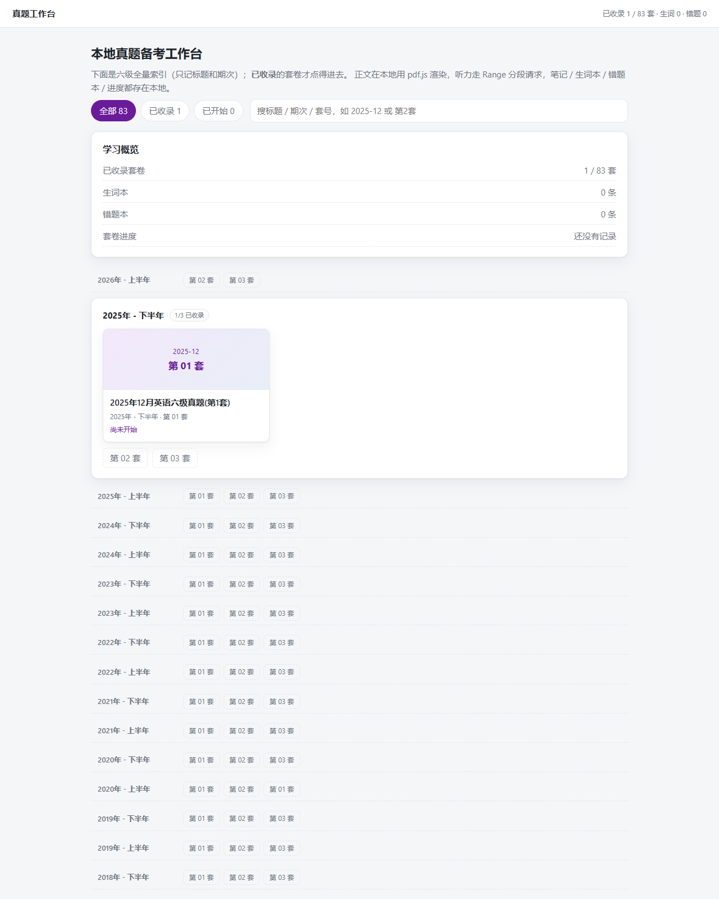
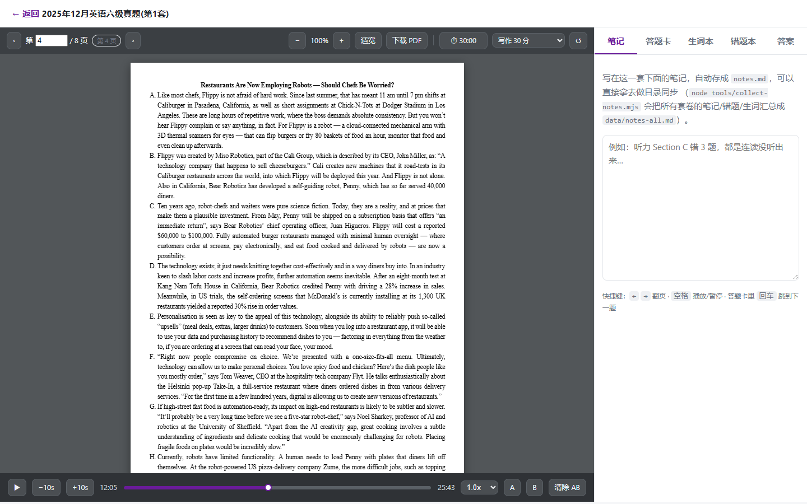
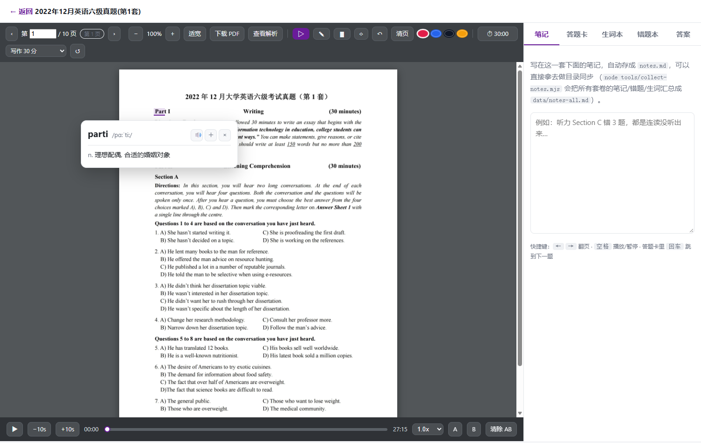
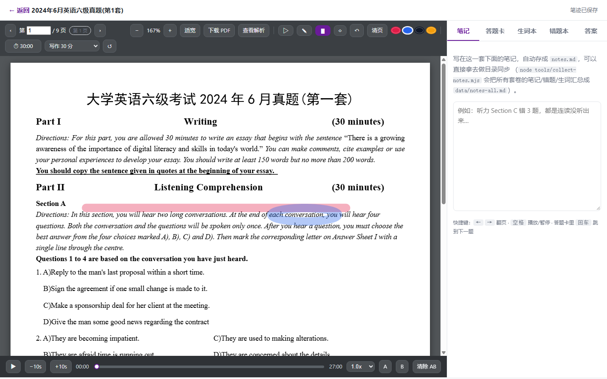
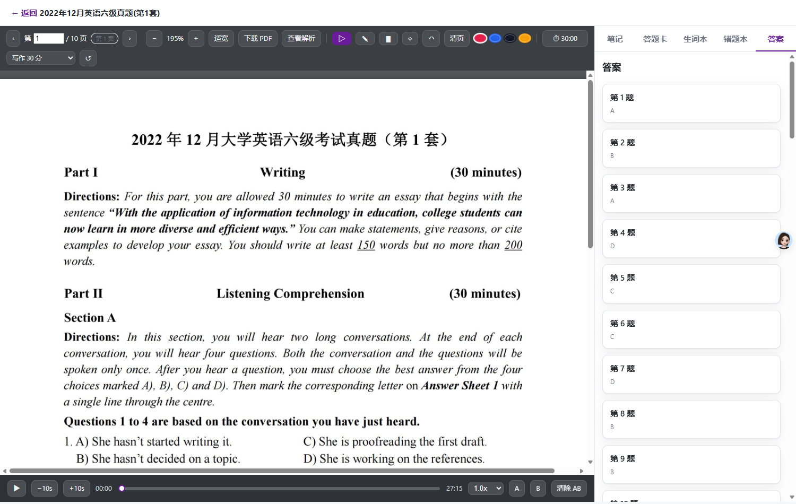
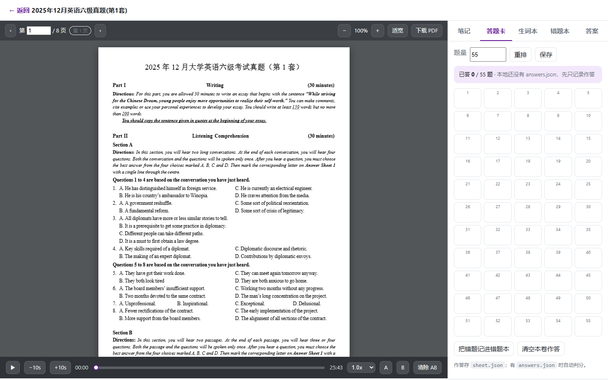

# zhenti-local

本地真题备考工作台。零依赖，只用 Node 内置模块 + 浏览器端 vendored pdf.js。

**它只索引你本地 `data/` 里已有的套卷，不联网抓取任何内容。**
四门考试一个入口：六级 83 套（2012–2026年6月）、四级 67 套（2016-12–2026-06）、专四 15 个考次（2011–2026）、专八 15 个考次（2011–2026），按考试类型切页签，只有**已收录**的套卷点得进去。



### 专四专八怎么来的

素材在仓库旁的 `tem4_archive/`（15 年网页归档）和 `tem8/`（15 年归档，其中 2022/2024/2025 拿到了带文字层的原卷 PDF）。导入走：

```bat
python tools\tem\ingest-tem.py --exam all      # 网页抽正文 → 重排 → 无头 Edge 打印成带文字层的 PDF
python tools\tem\extract-answers.py            # 能认出的答案表抽成 answers.json（宁缺勿错）
```

网页重排的卷子在 meta 里写明 `quality`（完整 / 部分缺哪些题型 / 回忆版）和来源文件；专八大都没有原卷，套卷页会如实提示「只有答案解析」，解析 PDF 照样能在侧栏看。

## 想从零搭一遍

`docs/BUILD-FROM-ZERO.md` 是按阶段写的复刻手册，讲架构分层、八个阶段的搭法（每段带验收标准）、技术栈取舍、25 条踩坑记录和交付前自测清单。

同目录的 `BUILD-FROM-ZERO.html` 是带左侧目录与全文搜索的单文件阅读版，由 `docs/build-reading-html.py` 生成（依赖 `markdown` + `pygments`）。

```bat
python docs\build-reading-html.py docs\BUILD-FROM-ZERO.md docs\BUILD-FROM-ZERO.html
```

## 跑起来

**双击 `start.bat`** 就行（Git Bash 里用 `./start.sh`）。它会自己找 node、端口被占自动往后顺延（8787→8799），服务就绪后自动开浏览器；想换端口或不开浏览器：

```bat
start.bat 9000          :: 指定端口
start.bat --no-open     :: 不开浏览器
./start.sh 9000 --no-open
```

手动起也行：

```bat
node server.mjs --port 8787
```

打开 http://127.0.0.1:8787/

改完代码要重启（**按端口**定位进程，不要按命令行模糊匹配）：

```powershell
powershell -NoProfile -ExecutionPolicy Bypass -File tools\restart-server.ps1 -Port 8787
```

## 功能

| 能力 | 说明 |
|---|---|
| 总目录 | 180 套索引（六级 83 / 四级 67 / 专四 15 / 专八 15），顶部按考试类型切页签；未收录的压成一行芯片 |
| 筛选 / 搜索 | 全部 / 已收录 / 已开始；按标题、期次（`2025-12`）、套号（`第2套`）搜 |
| 阅读 | pdf.js 渲染。整份 PDF 上下连续滚动，页码随可视页自动联动；可切单页 / 双页排列 |
| 缩放 | 25%–400% 固定比例 + 适合宽度 / 适合高度 / 完整页面，`−` `+` 微调，窗口 resize 自动重算 |
| 下载 | 「下载 PDF」是真下载（`<a download>` + 服务端 `?download=1` 发 attachment），不走 `window.open`（会被弹窗拦截） |
| 侧栏 | 右侧栏可折叠，折叠后右缘留「☰ 侧栏」展开钮；状态记 localStorage |
| 侧栏宽度 | 阅读区与侧栏之间有一条 6px 的把手：按住左右拖即可改宽度（280px ~ 900px，且左侧阅读区至少留 360px）；双击复位 380px，聚焦后 `←` / `→` 每次 ±24px（按住 Shift ±96px）；宽度记 localStorage 的 `zhenti:panelW` |
| 逐题解析 | `analysis.json` 挂每题解析（题号 / 答案 / 解析 PDF 页码 / 正文）。「答案与解析」页逐题展开，答题卡每题有「答案」和「解析」两个钮 |
| 解析 PDF | 顶部「查看解析」或卡片里的「解析 PDF 第 N 页」在**右侧栏**里打开解析 PDF，主阅读器保持试题不动；侧栏工具条可翻页（滚动联动页码）、缩放、「← 返回」收起；字太小点「全屏」才切到左侧阅读器整页看，再「← 返回试题」 |
| 听力逐题解析 | 官方 `analysis.pdf` 对听力只给答案和概要，逐题解析走补充数据 `tools/listening/<套卷 id>.json`（原文分段 + 题干 + 选项 + 解析）。`build-analysis.py` 会把它并进 `analysis.json` 的 `questions` 与 `listening`，答案页每组题前多一张可折叠的「听力原文」卡片 |
| 文字层 | canvas 之上铺一层透明文字，正文**可选中、可复制、Ctrl+F 能搜到** |
| 点词查词 | 文字层被切成逐词元素，**点哪个词查哪个**：音标、词性、中文释义，还带朗读和「＋生词本」。词库是 ECDICT 全量 77 万条，变形词自动回到原形（books→book、went→go） |
| 圈画 | 画笔 / 荧光笔 / 橡皮 / 撤销 / 清页，四种颜色；笔迹按页存 `ink.json`，坐标是相对页面的比例，**缩放后不会错位**，重开还在 |
| 划词入生词本 | 选中单词后浮出按钮，一点进生词本（超过 40 字的长选区不打扰） |
| 听力 | 倍速 0.75–2.0x、±10s、**AB 复读**、进度条（紫色=已播）；播放位置自动记住。mp3 / m4a 都认 |
| 听力复用 | 官方多套卷共用一份听力素材（2023.06 卷面上就印着"第三套与前两套一致"），所以第 3 套常没有独立音频。`meta.json` 里写 `audioRef` 指到同考次有音频的那套，播放条上标"复用 xxx" |
| 答题卡 | 每题直接点选，听力与仔细阅读 A–D，选词填空与段落匹配 A–O；再点一次取消，自动保存。选完**不自动判分**，点该题「答案」或顶部「全部显示答案」才显示正确项与 ✔/✘，「全部隐藏」可以收回 |
| 一键记错题 | 判错的题批量写进错题本（带"我选/正确答案"） |
| 笔记 | 每套一个 `notes.md`，可以直接拿去做目录同步 |
| 生词本 / 错题本 | 跨套共享，可增删 |
| 答案 | 六级 **61/76 套已自动填好**（站点 Worker 解密）；专四专八 7 套由归档答案页自动抽取（`tools/tem/extract-answers.py`，meta 里写明出处，未经人工核对）；其余留空不判 |
| 计时器 | 写作/听力/阅读/翻译/整卷分段限时，按墙上时间重算（后台节流也不漂），刷新后接着走 |
| 进度 | 阅读页码 / 听力位置 / 缩放自动落盘，重开接着看 |





## 目录结构

```
zhenti-local/
├─ server.mjs                    零依赖 HTTP 服务：静态资源 + 学习数据 API + 音频 Range
├─ public/
│  ├─ index.html / app.js        总目录、筛选、搜索
│  ├─ read.html / read.js        阅读器：pdf.js + 听力 + 笔记/答题卡/生词本/错题本/答案
│  ├─ app.css
│  └─ vendor/pdfjs/              pdf.js 4.10.38
├─ data/
│  ├─ papers.json                全量索引（只有元数据）
│  ├─ dict.json                  精简词库（2.4MB / 2.1 万词条 + 1 万条词形映射）
│  ├─ wordlist.json              从 76 套卷子里抽出的词表（建词库的原料）
│  ├─ notes-all.md               复习总纲（tools/collect-notes.mjs 生成）
│  ├─ study/{wordbook,wrong}.json
│  └─ cet6/2025-12/01/
│     ├─ meta.json               来源 URL、字节数、sha256、audioRef（复用听力时）
│     ├─ read.pdf  listen.mp3
│     ├─ ink.json                （可选）圈画笔迹，按页存
│     ├─ notes.md                笔记
│     ├─ progress.json           页码 / 听力位置 / 缩放
│     ├─ sheet.json              （可选）我的作答
│     └─ answers.json            （可选）标准答案 → 用于判分
├─ tools/
│  ├─ restart-server.ps1         按端口安全重启
│  ├─ check.mjs                  语法自检（改完代码先跑这个）
│  ├─ status.mjs                 只读体检：题库 / 收录情况 / 学习数据一览
│  ├─ collect-notes.mjs          汇总笔记/错题/生词 → data/notes-all.md
│  ├─ build-index.mjs            给已收录套卷补 sizes + sha256（只补字段，不裁索引）
│  ├─ ingest.mjs                 把 cet6 采集的直链灌进题库（挑最优一条，按真实格式落盘）
│  ├─ ingest-legacy.mjs          灌 2013.06—2015.12 旧考次（数据源 1e5e11 目录树，只有试题+解析）
│  ├─ collect-words.py           扫所有 read.pdf，抽英文词表 → data/wordlist.json
│  ├─ build-dict.py              把 ECDICT 裁成只含这些词的词库 → data/dict.json
│  ├─ browser-check.mjs          用 Chrome 调试协议真点一遍：查词弹不弹、笔迹存没存
│  ├─ build-analysis.py          把 analysis.pdf 拆成逐题解析，并合并听力补充数据
│  ├─ listening/                 听力原文与逐题解析补充数据（按套卷 id 命名）
│  └─ check-range.mjs            验证音频 Range 分段
└─ docs/REVERSE-ENGINEERING.md   站点结构逆向记录
```

## 常用命令

```bat
npm start                       :: = node server.mjs --port 8787
npm run check                   :: 语法自检，全部 JS 过 node --check
npm run status                  :: 只读体检（不开服务也能跑）
npm run digest                  :: 生成 data/notes-all.md（复习总纲）
npm run ingest                  :: 灌题：读 ../cet6/sources/CET6-MASTER.md 下载落盘
npm run ingest -- --dry         :: 只探测真实格式并打印计划，不下
npm run ingest -- --only 2019.06  :: 只灌一个考次
npm run dict:words              :: 扫全部 PDF 抽词表（加卷子后要重跑）
npm run dict:build              :: 用 .cache/ecdict.csv 重建 data/dict.json
npm run dict:full               :: 用 ECDICT 全量建 data/dict.db（77 万词条）
npm run answers                 :: 从站点取答案 → data/answers.json（需 9223 调试端口）
npm run answers:split           :: 拆成每套的 data/<套>/answers.json
npm run ocr:list                :: 列出哪些套是扫描件（无文字层）
npm run ocr                     :: 给扫描件补隐形文字层（RapidOCR）
```

**词库现在有两套。** `data/dict.json` 是早期版本，只收了 76 套卷子里**真正出现过**的词
（2.1 万条，含变形映射）；`data/dict.db` 是 ECDICT 全量转的 SQLite（77 万词条，带四六级/考研/雅思标签），
接在 `npm run dict:full`，服务端优先查它 —— 真题里出现的人名地名之外的词基本都能命中。
原料是 [ECDICT](https://github.com/skywind3000/ECDICT)（MIT），66MB 的 `ecdict.csv` 放在 `.cache/` 里。

**工具都是"只读或只补"的。** 早先有两个脚本（`final-check.mjs` / `reset-demo.mjs`）会直接删
`progress.json` 和生词/错题本，`build-index.mjs` 还会把 83 套索引覆盖成单套 —— 这些都已经删掉或改写了。
现在没有任何一个工具会删你的学习数据。

**改完代码先跑 `npm run check`。** 我踩过这个坑：调格式时把注释和下一行语句合并成了一行，
后半句直接变成注释内容，接口在运行时才炸 500（`limit is not defined`），静态检查能当场拦住。

## 复习总纲

`npm run digest` 把所有已收录套卷的笔记、错题（含"我选/正确答案"）、生词、进度和得分汇总成
一份 `data/notes-all.md`，可以直接当复习清单看。它只读文件系统，不需要服务在跑。

## 灌题（批量）

`tools/ingest.mjs` 读 `../cet6/sources/CET6-MASTER.md`（24 个考次、531 条已验证直链），
**每个套次只挑一条最优直链**下载，落进 `data/cet6/<年-月>/<套号>/`：

- 只灌 `papers.json` 里真实存在的套卷，不凭空造目录；
- 已存在的文件跳过（重复跑只会补失败的）；
- `papers.json` 只补 `files` 字段，**83 套索引一条都不会少**。

```bat
npm run ingest -- --dry            :: 先看计划
npm run ingest                     :: 全量（约 1.3 GB）
npm run ingest -- --year 2025      :: 只灌某一年
```
想省空间用 `--audio m4a`（听力优先挑体积小的 m4a）。

### 旧考次（2013.06 — 2015.12）

主采集清单 `CET6-MASTER.md` 只覆盖 2016.06 起。2013.06 至 2015.12 这五个考次的真题
在 `1e5e11/CET46-Resources` 仓库的 `六级真题/` 目录里其实一直有，只是当初采集脚本跳过了。
用 `tools/ingest-legacy.mjs` 补灌：

```bat
node tools/ingest-legacy.mjs --dry      :: 先看计划
node tools/ingest-legacy.mjs            :: 灌 14 套（试题 + 解析，共约 60 MB）
```

这些旧考次**没有听力音频**（1e5e11 仓库的听力从 2016.06 才开始收录），所以补进来的是
正文 + 解析两件。2012 两个考次和 2014.12 的六级真题在任何已探测的公开 GitHub 源里都不存在
（只有网盘资源，无稳定直链），暂时无法收录。

## 加一套新卷

1. 建目录 `data/<考试>/<年-月>/<套号>/`，放 `read.pdf`、`listen.mp3`（或 `listen.m4a`）。
2. `data/papers.json` 里在对应套卷对象上补 `files` 等字段（索引本身已经全量生成好了，不用自己敲 83 条）。
3. 想记校验和：`node tools/build-index.mjs`。

## 答案与判分

答案现在能自动取了，不用手动整理。

站点把答案密文放在试卷页的 `globalConfig.newAnswer` 里（`{ciphertext, p, n, data}` 四段），
**解密由站点自己的 Worker 完成**（`/javascripts/read_zhenti_web_worker.js`）。所以不需要逆向加密算法：
在同源页面里 fetch 到密文，往 Worker 里 post 一条 `decryp_msg_ans`，拿回来的就是明文。

```bat
:: 前提：一个已登录站点的 Edge 开着 --remote-debugging-port=9223
npm run answers                 :: 83 套全跑，约 2 分钟，边跑边落盘
npm run answers -- --only cet6/2025-06/01
npm run answers:split           :: 拆成每套的 answers.json
```

- 站点给的是 `["1-C", "2-B", …]`，本地要的是 `{"1": "C", "2": "B"}`，`distribute-answers.mjs` 负责转换。
- 实际覆盖 **61/76 套**。第 3 套只提供 26 题以后的答案（前 25 题与前两套共用），所以那几套只有后半段能判分。
- **2013.06 — 2015.12 这 14 套站上压根没有答案按钮**，`analysis.pdf` 里也只覆盖 20 多题正文、
  2015 那几套还是扫描件，硬抽容易把题干选项当成答案。宁可留空不判，也不写错的答案进去。
  `cet6/2022-06/03` 在站上是 404，同样留空。

标准答案是 `data/<套>/answers.json`，格式：

```json
{ "1": "A", "2": "B", "notes": "任意补充说明" }
```

- 只有出现在这个文件里的题号才会判分；**没有答案的题保持"未判"**，不会被误判成错。
- 你的作答存 `data/<套>/sheet.json`，与标准答案分开，互不覆盖。
- 题量（默认 55）只决定界面上排多少格，**调小题量不会丢已填的答案**。




## 扫描件补文字层

**已经跑完了：76 套 731 页全部有文字层，点哪套都能查词。**

原先有 13 套是纯图片 PDF（2021.12 起几个考次），另外 6 套里还夹着 8 个纯图页
（`2018-06/03` 第 3、4、6 页，`2020-09/01` 第 10 页，`2021-12/01` 第 11 页，2025.06 三套的封面）。
`tools/ocr/ocr-pdf.py` 干的事：

1. 用 PyMuPDF 按 200 dpi 把每页渲染成图；
2. RapidOCR（PP-OCRv6，英文模型）识别每一行；
3. 把识别结果按原坐标以 `render_mode=3`（不可见）写回 PDF。

页面上看不出任何变化，但 pdf.js 的文本层能选中、能框词，查词功能照样用。
原文件先备份到 `.cache/ocr/backup/`，写入用 `saveIncr()` 增量追加，不改动原有内容。

```bat
npm run ocr:list                          :: 先看还有哪些页面要补
node tools/ocr/ocr-pdf.py --only cet6/2018-06/03
npm run ocr                               :: 全部补一遍（已经有字的页自动跳过）
```

判断分两层：整本没字（前 3 页合计 < 200 字）就把 13 页全交出去，否则只挑单页 < 120 字的那几页。
所以重跑是幂等的，不会给已经补好的页盖第二层文字。

代价是慢：CPU 上大约 20 秒一页，一套 10 页 4 分钟左右。136 页跑了一小时出头。

> 两个进程同时处理同一套会互相覆盖（都在对同一个文件 `saveIncr()`），批量跑之前先看一眼
> `Get-CimInstance Win32_Process -Filter "Name='python.exe'"`。

## API

| 方法 | 路径 | 说明 |
|---|---|---|
| GET | `/api/papers` | 全量索引 + 每套的 `local` / `progress` / `sheet` 状态 + `counts` |
| GET | `/api/paper?id=…` | meta + 笔记 + 进度 + 标准答案 + 我的作答 |
| POST | `/api/notes` | `{ id, content }` 写 notes.md |
| POST | `/api/progress` | `{ id, page, audioTime, scale }` |
| POST | `/api/sheet` | `{ id, count, answers }` 存作答 |
| GET | `/api/study` | 生词本 + 错题本 |
| POST | `/api/study` | `{ collection, item }` 或 `{ collection, remove }` |
| GET | `/api/dict?word=…` | 查词。先按原形查，查不到走词形映射；都没有就 `hit:false` |
| GET | `/api/ink?id=…` | 这一套的笔迹 `{ pages: { "1": [stroke…] } }` |
| POST | `/api/ink` | `{ id, pages }`，坐标 0~1、线宽按页宽比例存 |
| GET | `/api/overview` | 学习概览 |

## 开发时踩过的坑（都会再踩，所以写下来）

1. **pdf.js 依赖 `requestAnimationFrame`**：标签页 `visibility: hidden` 时 `page.render().promise` 永远不 resolve，
   没有报错、就是卡住 —— 排查先看 `document.visibilityState`。窗口可见时一切正常。
2. **pdf.js 一个 canvas 只能有一个 render 在跑**，翻页/缩放并发会抛
   `Cannot use the same canvas during multiple render() operations`，渲染要串行化。
3. **flex/grid 子项的 `min-height` 默认是 `auto`**：长内容会把兄弟节点顶出视口。
   阅读器底部的播放条就因此被 `overflow:hidden` 裁掉过，`.viewer-scroll` / `.tabbody` 必须显式 `min-height: 0`。
4. **`<input>` 的 `value` 属性不随 `.value` 变**，别拿 DOM 序列化结果做输入框断言。
5. **PowerShell**：`$PID` 是只读自动变量（赋值失败会变成"杀自己"）；`.ps1` 没有 BOM 时按 ANSI 读，中文注释会直接解析失败；
   把原生命令输出 `| Out-File` 会按 GBK 重解码毁掉 UTF-8 —— 用 `cmd /c "… > file"`。
6. **rea 的 `fill` 动作在本项目页面上会挂住**（场景超时），截图场景只用 `click` / `wait_for_timeout`。
7. **改格式也会改坏代码**：把注释和下一行语句之间的换行删掉，后半句就成了注释内容
   （表现为某个接口 500 `limit is not defined`）。这类错静态检查能拦，所以有 `npm run check`。
8. **写文件要原子**：`writeFile` 写到一半崩掉会毁掉 `study/*.json`。服务端统一走
   "写 `.tmp` 再 `rename`"。
9. **URL 后缀不等于真实格式**：采集来的听力里，`listening.mp3` 的文件头是 `ftyp`，
   其实是 M4A。按 URL 后缀挑文件、按后缀命名都会错（浏览器拿 `audio/mpeg` 去解 AAC 容器播不了）。
   所以 `ingest.mjs` 先 Range 抓前 16 字节嗅探，落盘名按真实格式走，服务端 MIME 也补了 `.m4a`。
   判格式看文件头：`%PDF` / `ftyp`（offset 4）/ `ID3` / `0xFF 0xFB`。
10. **pdf.js 4.x 的文字层要 `--scale-factor`**：`new pdfjsLib.TextLayer({ textContentSource, container, viewport })`
   里的字号是 `calc(var(--scale-factor) * Npx)`，容器上没设这个变量文字就全叠在一起。缩放改变时必须重设。
   文字层是透明覆盖层，视觉上和 canvas 完全重合（截图看不出差别），但它是"能选中/能搜"的前提。
11. **别按命令行模糊匹配杀进程**：有次用 `CommandLine -like '*server.mjs*'` 杀进程，
    把两个不属于本项目的 node 一起杀了。只按端口或 PID 杀（`tools/restart-server.ps1` 就是按端口）。

## 边界

只做**单套自用**的离线整理。不整库镜像、不重写答案解密、不绕过设备绑定。

两件事受源材料限制，不是没做：

- **15 套没有标准答案。** 13 套（2013.06—2015.12）站上就没有答案入口，`cet6/2022-06/03` 是 404，
  剩下的解析 PDF 抽不干净。这几套照样能作答、记笔记、圈画、听音频，只是不判分。
- **2026 年的卷子只有 6 月三套。** 12 月要等站上放出来。
